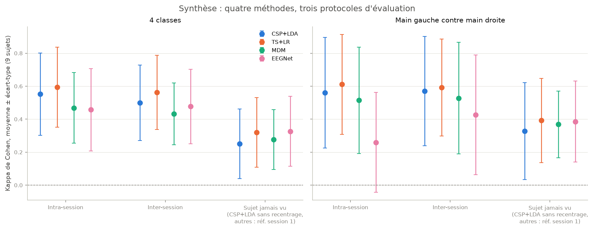

# Interface cerveau-machine par imagerie motrice

Décoder, à partir de l'EEG, le mouvement qu'une personne **imagine** (main gauche, main droite, pieds, langue),
et mesurer honnêtement ce qui fonctionne : méthode classique (CSP + LDA), géométrie riemannienne et deep learning
(EEGNet), d'une séance à l'autre et sur des personnes jamais vues.

Projet de portfolio de **Bilal Mokeddem**, élève-ingénieur en Numérique, Santé et IA (EIJV Amiens).

> **Rapport complet, rédigé pour être lisible sans prérequis :** [`results/synthese.md`](results/synthese.md)
> (but et démarche de chaque phase, tests statistiques expliqués, résultats, limites, glossaire).



## Résultats principaux

Kappa de Cohen (0 = hasard, 1 = parfait), moyenne ± écart-type sur les 9 personnes du jeu
**BCI Competition IV 2a**. Tableau généré automatiquement à partir de `results/` par `src/synthese.py`.

<!-- RESULTATS:DEBUT -->
| Tâche | Méthode | Intra-session | Inter-session | Sujet jamais vu* |
|---|---|---|---|---|
| 4 classes | CSP+LDA | 0,552 ± 0,250 | 0,499 ± 0,229 | 0,251 ± 0,211 |
| 4 classes | TS+LR | 0,593 ± 0,243 | 0,562 ± 0,225 | 0,319 ± 0,211 |
| 4 classes | MDM | 0,468 ± 0,214 | 0,432 ± 0,188 | 0,276 ± 0,181 |
| 4 classes | EEGNet | 0,457 ± 0,249 | 0,477 ± 0,226 | 0,327 ± 0,212 |
| Main gauche contre main droite | CSP+LDA | 0,561 ± 0,336 | 0,571 ± 0,331 | 0,327 ± 0,293 |
| Main gauche contre main droite | TS+LR | 0,611 ± 0,303 | 0,591 ± 0,294 | 0,392 ± 0,256 |
| Main gauche contre main droite | MDM | 0,515 ± 0,323 | 0,528 ± 0,339 | 0,369 ± 0,202 |
| Main gauche contre main droite | EEGNet | 0,259 ± 0,303 | 0,426 ± 0,363 | 0,386 ± 0,245 |
<!-- RESULTATS:FIN -->

\* *Sujet jamais vu* : modèle appris sur les 8 autres personnes. TS+LR et MDM avec recentrage riemannien,
EEGNet avec alignement euclidien, dont la référence est calculée sur la première session de la nouvelle personne,
**sans ses étiquettes** ; CSP+LDA sans recentrage.

Ce qu'il faut retenir :

1. **Le signal est là et il est conforme à la physiologie** : imaginer une main désynchronise les rythmes
   mu (8-12 Hz) et beta (13-30 Hz) au-dessus du cortex moteur opposé.
2. **La géométrie riemannienne (TS+LR) a la meilleure moyenne** dans tous les protocoles intra- et inter-session,
   sans réglage. Avec 9 personnes, son avance sur CSP + LDA reste une tendance (non significative après correction).
3. **Un modèle générique perd beaucoup sur une personne jamais vue** (en 4 classes, TS+LR passe de 0,56 à 0,21 de
   kappa) ; le recentrage riemannien, sans aucune étiquette, en récupère une part importante.
4. **EEGNet souffre de surapprentissage avec quelques centaines d'essais**, mais rejoint les meilleures méthodes
   quand il est entraîné sur plusieurs personnes.
5. **Les écarts entre personnes dépassent largement les écarts entre méthodes** (« illettrisme BCI »).

## Ce que ce projet cherche à montrer

- **Aucune fuite de données** : tout ce qui apprend (filtres CSP, moyennes de référence, classifieurs, réseaux)
  est réappris dans chaque pli ; les réglages sont fixés a priori, jamais ajustés sur le test ; la seconde session
  n'est pas regardée pendant l'exploration.
- **Comparaisons équitables** : toutes les méthodes, y compris EEGNet, passent par la même boucle d'évaluation,
  avec les mêmes essais et les mêmes plis.
- **Statistiques adaptées** : niveau du hasard par permutation des étiquettes, tests de Wilcoxon appariés,
  correction de Holm pour les comparaisons multiples.
- **Vérifications plutôt que suppositions** : position des marqueurs contrôlée contre les fichiers officiels de la
  compétition, noms d'API vérifiés dans les versions installées, résultats régénérés à l'identique.
- **Aucun chiffre saisi à la main** : rapport et tableau ci-dessus sont produits à partir des CSV de `results/`.

## Méthodes

| Phase | Contenu | Script | Notebook |
|---|---|---|---|
| 0 | Environnement, versions figées, chargement des données | `src/verifier_environnement.py` | |
| 1 | Neurophysiologie : ERD mu/beta, cartes temps-fréquence, topographies, latéralisation | `src/phase1_exploration.py` | `01_exploration_neurophysiologique` |
| 2 | Référence CSP + LDA, binaire et 4 classes, intra- et inter-session, permutations | `src/phase2_csp_lda.py` | `02_csp_lda` |
| 3 | Géométrie riemannienne : espace tangent + régression logistique, MDM, Wilcoxon | `src/phase3_riemann.py` | `03_geometrie_riemannienne` |
| 4 | Généralisation inter-sujets (leave-one-subject-out), recentrage riemannien | `src/phase4_inter_sujets.py` | `04_generalisation_inter_sujets` |
| 5 | EEGNet (braindecode), mêmes protocoles ; GPU via Google Colab | `src/phase5_eegnet.py` | `05_eegnet_colab` |
| 6 | Relance complète et rapport de synthèse | `src/tout_relancer.py`, `src/synthese.py` | |

## Structure

```
bci-imagerie-motrice/
  src/                 code réutilisable (chargement, pipelines, évaluation, alignement, figures, scripts de phase)
  notebooks/           exploration et visualisation (01_ à 05_), générés par construire_notebooks.py
  results/             scores (CSV), rapport de synthèse, journaux d'exécution (non versionnés)
  reports/figures/     figures PNG (150 dpi)
  requirements.txt     versions exactes des bibliothèques
```

## Reproduire les résultats

Prérequis : Python 3.13, environ 1 Go d'espace disque pour les données (téléchargées automatiquement par MOABB
dans `~/mne_data`, hors du dépôt).

```powershell
python -m venv .venv
.venv\Scripts\python.exe -m pip install --extra-index-url https://download.pytorch.org/whl/cpu -r requirements.txt

# Tout relancer (plusieurs heures sur un CPU de portable, à cause des permutations et d'EEGNet)
.venv\Scripts\python.exe -m src.tout_relancer

# Sans réentraîner EEGNet
.venv\Scripts\python.exe -m src.tout_relancer --sans-eegnet

# Une étape précise
.venv\Scripts\python.exe -m src.tout_relancer --etapes phase3 synthese
```

Durées mesurées lors de la dernière relance complète (portable, Intel Core i3-1315U, sans GPU) :

<!-- DUREES:DEBUT -->
| Étape | Durée mesurée |
|---|---|
| versions et chargement du sujet 1 | 0,3 min |
| exploration neurophysiologique (ERD) | 4,9 min |
| CSP + LDA avec 100 permutations | 66,4 min |
| TS+LR et MDM, tests appariés | 3,0 min |
| leave-one-subject-out et recentrage | 5,3 min |
| EEGNet inter-session (CPU) | 56,4 min |
| EEGNet : graines et surapprentissage | 17,7 min |
| results/synthese.md et README | 0,1 min |
| génération et exécution des notebooks 01 à 04 | 0,7 min |
| **Total** | **154,8 min** |
<!-- DUREES:FIN -->

EEGNet en intra-session et en inter-sujets se calcule sur GPU avec `notebooks/05_eegnet_colab.ipynb`.

**Reproductibilité vérifiée :** une relance complète depuis zéro redonne à l'identique tous les fichiers de résultats et
toutes les figures des méthodes classiques. Seul EEGNet sur CPU peut différer très légèrement entre deux exécutions
(un essai sur 144 pour 2 personnes sur 9 lors de la vérification), car certains calculs parallèles de PyTorch ne sont
pas strictement déterministes.

## Données

[BCI Competition IV 2a](https://www.bbci.de/competition/iv/) (Brunner et al., 2008), via MOABB (`BNCI2014_001`) :
9 personnes, 22 électrodes EEG, 250 Hz, 4 classes, 2 sessions de 288 essais enregistrées des jours différents.

## Références

- Pfurtscheller et Lopes da Silva (1999). Event-related EEG/MEG synchronization and desynchronization.
- Ramoser, Müller-Gerking et Pfurtscheller (2000). Optimal spatial filtering of single trial EEG during imagined hand movement (CSP).
- Barachant, Bonnet, Congedo et Jutten (2012). Multiclass brain-computer interface classification by Riemannian geometry.
- Zanini, Congedo, Jutten, Said et Berthoumieu (2018). Transfer learning: a Riemannian geometry framework with applications to brain-computer interfaces.
- He et Wu (2019). Transfer learning for brain-computer interfaces: a Euclidean space data alignment approach.
- Lawhern et al. (2018). EEGNet: a compact convolutional neural network for EEG-based brain-computer interfaces.
- Haufe et al. (2014). On the interpretation of weight vectors of linear models in multivariate neuroimaging.
- Jayaram et Barachant (2018). MOABB: trustworthy algorithm benchmarking for BCIs.
